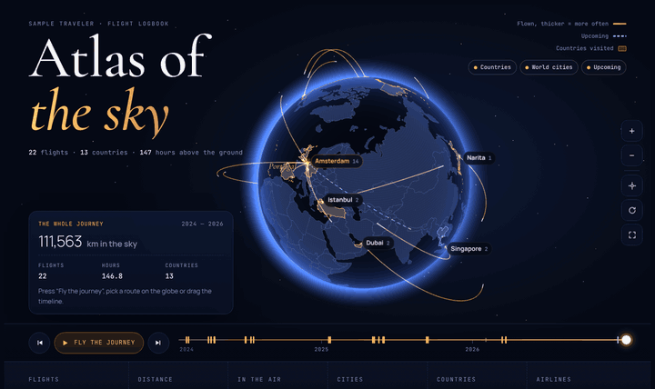

<div align="center">

# ✈ Flight Atlas

**Give Claude access to your inbox. Get back a 3D atlas of every flight you've ever taken.**

[Live demo (sample traveler)](https://vladpomogaev.github.io/flight-atlas/sample.html) · [Live demo (real inbox, in Russian)](https://vladpomogaev.github.io/flight-atlas/) · [Русская версия](#-по-русски)



</div>

---

Flight Atlas is a [Claude skill](https://docs.claude.com/en/docs/agents-and-tools/agent-skills/overview). You say *"make my flight atlas"*, Claude searches your mail for boarding passes, e-tickets, check-in reminders and receipts, pulls out every segment, asks you about the gaps, and builds a single self-contained web page:

- **A glowing 3D globe** with real country borders. Routes get thicker the more often you fly them; countries you've visited light up.
- **"Fly the journey"**: a little plane replays every flight in order while the camera follows. Pause, step forward and back, or drag the timeline to watch your map grow.
- **Stats**: flights, kilometres, hours in the air, cities, countries, airlines.
- **Year by year** calendar, **records** (longest, shortest, farthest from home, busiest day), **country silhouettes**, a **departure-board log**, routes and hours per airline.
- English and Russian UI, phone-friendly, no backend. One HTML file you can host anywhere.

Example from a real inbox: 19 flights, 40,140 km (exactly once around the equator), 65 hours in the air, 6 countries, found among years of inbox noise, including old airline domains, fiscal receipts and a tour-operator voucher.

## Install

**claude.ai / Claude desktop**
1. Download [`flight-atlas.zip`](https://github.com/vladpomogaev/flight-atlas/releases/latest/download/flight-atlas.zip).
2. Settings → Capabilities → Skills → Upload skill.
3. Connect Gmail (or another mail connector).
4. Ask: **"Find all my flights in my email and make me a flight atlas."**

**Claude Code**
```bash
git clone https://github.com/vladpomogaev/flight-atlas
cp -r flight-atlas/skill/flight-atlas ~/.claude/skills/
```

## Build it by hand

No Claude? Write `flights.json` and run the builder (Node 18+):

```bash
cd skill/flight-atlas/scripts && npm install
node build.mjs ../examples/sample.en.json my-atlas.html
```

```json
{
  "owner": "Jane Doe",
  "lang": "en",
  "home": "AMS",
  "flights": [
    {"date": "2024-04-03", "flight": "KL641", "airline": "KLM", "from": "AMS", "to": "JFK", "minutes": 500},
    {"date": "2026-12-19", "flight": "KL835", "airline": "KLM", "from": "AMS", "to": "BKK", "status": "upcoming"}
  ]
}
```

`status` is `flown` (default), `upcoming` or `refunded`. Leave out `minutes` and the builder estimates them from distance. 5,300+ airports are bundled; airports of one city are grouped automatically (SVO/VKO/DME → Moscow, JFK/LGA/EWR → New York).

## Privacy

Everything runs inside your Claude session and the page has no backend. The data file holds only dates, flight numbers, airports and durations, no booking codes or document numbers. If you publish your atlas, consider leaving out upcoming trips: a public page with future dates tells strangers when you're away.

## How it finds flights

One search never finds everything. The skill runs several passes: keywords in English and Russian, dozens of airline and agency sender domains (including renamed ones such as `pobeda.aero` → `flypobeda.ru`), fiscal receipts that carry ticket numbers, Promotions/Trash, and a "gap hunt" around trips it can infer from hotels, airport trains or a haircut in another city. Details: [`search-playbook.md`](skill/flight-atlas/references/search-playbook.md).

## Credits

Airports: [OurAirports](https://ourairports.com/data/) (public domain). Borders: [Natural Earth](https://www.naturalearthdata.com/) via [world-atlas](https://github.com/topojson/world-atlas). Rendering: [three.js](https://threejs.org/). Country names: [i18n-iso-countries](https://github.com/michaelwittig/node-i18n-iso-countries).

Made by [Vladislav Pomogaev](https://github.com/vladpomogaev) with Claude. MIT license. Star the repo if your atlas surprised you, and share a screenshot with **#FlightAtlas**.

---

## 🇷🇺 По-русски

**Даёте Claude доступ к почте — получаете 3D-атлас всех своих перелётов.**

Это скилл для Claude. Скажите *«найди все мои перелёты в почте и сделай атлас»*: Claude найдёт посадочные, маршрутные квитанции, напоминания о регистрации и чеки ОФД, вытащит каждый сегмент, спросит про пробелы и соберёт страницу:

- 3D-глобус с реальными границами: чем чаще маршрут, тем толще линия, посещённые страны подсвечены;
- кнопка «Пролететь путь»: самолётик пролетает все рейсы по порядку, можно ставить на паузу, листать и тянуть шкалу времени;
- налёт, часы в небе, города, страны, авиакомпании, календарь по месяцам, рекорды, силуэты стран, журнал рейсов.

**Установка в claude.ai:** скачайте [`flight-atlas.zip`](https://github.com/vladpomogaev/flight-atlas/releases/latest/download/flight-atlas.zip) → Настройки → Возможности → Навыки → Загрузить. Подключите Gmail и попросите: **«Найди все мои перелёты в почте и сделай атлас неба»**.

[Мой атлас](https://vladpomogaev.github.io/flight-atlas/) — 19 рейсов, 40 140 км, 65 часов в воздухе.
